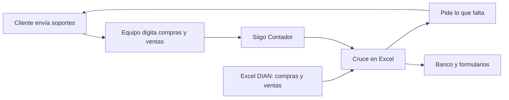
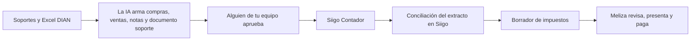

# Cierre mensual de Taxplan: lo que entendimos

**Para:** Meliza Ramírez Granados, Taxplan Consulting SAS
**De:** David Vargas y Julián, Webby
**Fecha:** 18 de noviembre de 2026

Meliza, gracias por la conversación del 5 de noviembre. Esta página resume cómo entendimos tu cierre mensual, qué proponemos para cada dolor y qué necesitamos ver en una empresa.

No es un precio. Siigo Contador sigue siendo tu libro. Lo que proponemos es una consultoría para automatizar los dolores principales, empezando por una empresa, sin cambiar de sistema.

## Cómo cierra el mes hoy

Los soportes llegan por WhatsApp, correo, físico o USB. En paralelo, el reporte de la DIAN trae en Excel las compras y las ventas. El equipo digita las dos cosas, cruza en Excel, pide lo que falta y concilia el banco. Los cierres empiezan hacia el día 9 del mes siguiente. El día exacto para presentar lo da el último dígito del NIT.

El orden que nos contaste es este:

1. **Causar.** Compras, ventas, notas crédito, notas débito y documento soporte. Cada una con su número, su NIT, su CUFE o CUDE, y el soporte ligado. La retención depende de la calidad tributaria del tercero. Sin NIT, ese gasto no se puede descontar.
2. **Conciliar.** Cada banco contra los libros. Una factura puede cobrarse o pagarse a 30, 60, 80 o 90 días, así que no siempre cae en el banco del mismo mes.
3. **Liquidar.** Retefuente e IVA, y si aplican, ICA, impuesto al consumo y autorretención. Tú apruebas antes de presentar.
4. **Nómina.** El cliente arma la nómina. Tú cruzas la nómina electrónica, la planilla de seguridad social y el desprendible contra el banco. La prima y el descanso remunerado no siempre están en la planilla. No liquidas la nómina.

## Lo que proponemos

Siigo Contador se queda como libro. En Siigo Contador la factura electrónica se contabiliza a mano, así que la causación la arma una herramienta de IA y una persona la aprueba antes de que entre al libro. La conciliación contra el extracto y la exógena se usan dentro de Siigo, que ya las ofrece.

| Dolor | Qué hace el agente | Solución propuesta |
|---|---|---|
| Causar compras, ventas y documento soporte a mano | Trae compras y ventas de la DIAN, incluye notas y documento soporte, propone cuenta, IVA y retención según el régimen del tercero, guarda número de factura y NIT, y deja el soporte ligado | El comprobante queda armado en Siigo y no se contabiliza si falta el NIT, si el CUFE ya existe, si la nota crédito ya anuló ese valor, si en una compra a crédito faltan el acuse y el recibo del bien, o si nadie lo aprobó |
| Conciliar con resaltador | Lee el extracto en Siigo, cruza contra el auxiliar y separa lo que coincide de lo que no | Comisión y GMF se cierran con una regla. Un pago a 30, 60, 80 o 90 días, un anticipo o un valor sin pareja quedan para una persona |
| Pedir soportes dos veces al mes, y no ver cómo va cada empresa | Compara la DIAN, lo recibido y lo causado, le manda a cada cliente solo lo que le falta, y deja el estado de cada empresa en la semana de su cierre | Un recordatorio por empresa con la lista exacta de faltantes, y una lista con lo causado, lo conciliado y lo pendiente. No insiste sobre un documento que ya está causado |
| Reembolso de caja desde la foto | Lee el recibo y arma las líneas con el total | El borrador entra cuando alguien verifica que el total cuadra |
| Miedo a la sanción | Arma el borrador de retefuente, IVA y, si aplica, ICA, consumo y autorretención, con el soporte de cada cifra | Meliza revisa el borrador. El agente no presenta ni paga |
| Nómina que no cuadra con el banco | Cruza nómina electrónica, planilla y desprendible contra el egreso del banco | Lista de diferencias. La prima y el descanso remunerado no siempre están en la planilla, así que esa diferencia no se marca como error. El agente no ajusta el libro y no liquida la nómina |

## Las automatizaciones, una por una

### 1. Causación desde la DIAN

La causación automática sincroniza los documentos con la DIAN, sugiere la causación y los sube a Siigo. Entra la compra, la venta, la nota crédito, la nota débito y el documento soporte. El documento soporte es la cuenta de cobro que no es factura: se procesa para que la DIAN la vea. En cada documento se guardan el número y el NIT, y queda ligado al soporte, sea el XML o el físico. A fin de año, si un medio magnético no cuadra, se puede volver a ese soporte. La exógena no se construye en esta etapa.

La retención no sale solo del régimen de tu cliente. Sale de la calidad de la otra parte: régimen simple, gran contribuyente o autorretenedor. Si esa calidad no está identificada, la retención queda marcada y no se liquida sola.

En una compra a crédito, el costo y el IVA descontable dependen del acuse y del recibo del bien. Si esos eventos no están, el documento queda marcado y no se toma como soporte. Una nota crédito disminuye o anula la factura: el valor anulado deja de ser soporte.

Alguien de tu equipo revisa antes de confirmar. Más adelante podemos desarrollar esa misma causación para que quede inmediata y baje el costo.

### 2. Conciliación bancaria

La conciliación se hace en Siigo, con el extracto del banco. El sistema compara cada movimiento contra el auxiliar y propone cuáles se pueden cerrar. Comisión y GMF entran por regla. Un pago a plazo, un anticipo o un valor sin pareja no entra solo al libro.

### 3. Borrador de impuestos

Con el libro cuadrado, el borrador sale del balance por tercero.

- Retefuente: mensual, del mes vencido. El día lo da el último dígito del NIT. La tarifa depende de la calidad tributaria del tercero.
- IVA: bimestral o cuatrimestral, según el régimen de esa empresa.
- ICA: municipal. Entra al borrador solo si la empresa lo declara.
- Impuesto al consumo y autorretención: solo si a esa empresa le aplican.

Tú comparas el borrador con el formulario. El agente no presenta ni paga.

### 4. Soportes por cliente y recordatorios

Cada cliente tiene un espacio propio, por NIT. Ve y carga solo sus documentos. Antes de cada cierre recibe la lista exacta de lo que falta, no un mensaje general. En la semana de cierre de cada empresa se ve qué está causado, qué está conciliado y qué sigue pendiente. Arrastrar y soltar los archivos puede esperar. El espacio separado, no.

### 5. Lo que puede ir después

No cambia la declaración. Queda para cuando la primera etapa ya corra con unas pocas empresas:

- Arrastrar y soltar los soportes.
- Un tablero para que el cliente vea en qué va su mes.
- Causación inmediata, sin esperar el lote, y con menor costo.

## Lo que queda fuera de esta etapa

- Reemplazar Siigo.
- Presentar o pagar en la DIAN o en un municipio.
- Declaración de renta de personas jurídicas. Solo se hace el cierre mensual.
- Construir la información exógena. Sí se guardan número de factura y NIT.
- Liquidar la nómina. El cruce sí entra.
- Declaraciones de personas naturales.
- Página, certificados en línea y chatbot.
- Obligar a tus clientes a dejar el WhatsApp o el físico.

La primera etapa sería con cinco o seis empresas, no con todas.

## Qué necesitamos ver en una empresa

Con una empresa en pantalla, y un mes, nos alcanza. Si no tienes el mes cerrado a la mano, vemos lo que tengas.

1. El Excel de la DIAN, un extracto y el balance de prueba de un mes ya cerrado.
2. Cuántas facturas y cuántos bancos tiene un mes típico de esa empresa.
3. Si el reembolso de caja de esa empresa pesa en el cierre del mes.
4. Si esa empresa es la ganadería de tres negocios, y si el inventario de animales cambia el cierre del mes.

## Siguiente paso

1. Nos reunimos una vez, con una empresa en pantalla.
2. Vemos la conciliación con extracto dentro de Siigo Contador.
3. Probamos la causación automática en esa empresa, sin cambiar el libro.
4. Te enviamos la propuesta de consultoría por dolor, con precio.

Si algo de esta página no coincide con tu operación, dínoslo y lo corregimos.
