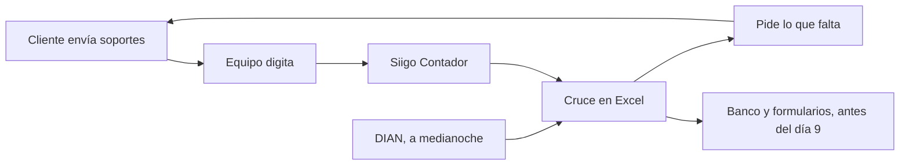
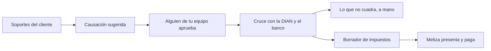
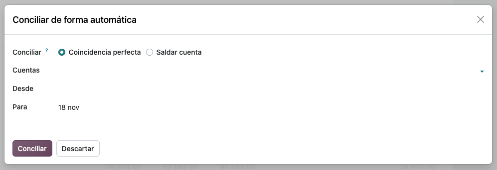
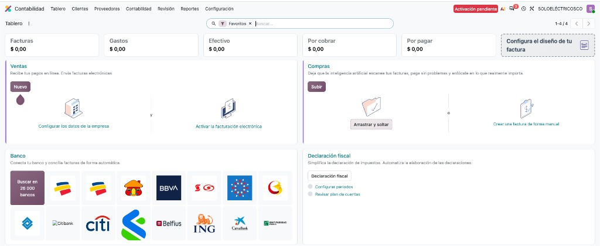

# Cierre mensual de Taxplan: lo que entendimos

**Para:** Meliza Ramírez Granados, Taxplan Consulting SAS
**De:** David Vargas y Julián, Webby
**Fecha:** 18 de noviembre de 2026

Meliza, gracias por la conversación del 5 de noviembre. Esta página resume cómo entendimos tu cierre mensual, cómo se vería resuelto y qué necesitamos confirmar contigo.

No es una propuesta ni un precio. Siigo Contador sigue siendo tu libro. Las pantallas de más abajo son de Odoo Accounting 19, con datos de demostración de la [documentación oficial de Odoo](https://www.odoo.com/documentation/19.0/applications/finance/accounting.html). Las de DIAN y certificados son de la [localización de Colombia](https://www.odoo.com/documentation/19.0/applications/finance/fiscal_localizations/colombia.html). Sirven para mostrarte una forma de trabajar. La herramienta se define después de ver cómo lo haces hoy en Siigo.

## Cómo cierra el mes hoy

Los soportes llegan por WhatsApp, correo, físico o USB. En paralelo, el reporte de facturación electrónica de la DIAN queda disponible a la medianoche. El equipo digita, cruza en Excel, pide lo que falta y concilia el banco. El cierre de cada empresa tiene que estar listo antes del día 9 del mes siguiente.

El orden que nos contaste es este:

1. **Causar.** Reconocer cada factura como gasto, con su IVA y su retención según el NIT. Sin NIT, ese gasto no se puede descontar.
2. **Conciliar.** Cada banco contra los libros. Lo que no cuadra se revisa a mano: anticipo, diferido, pago de otro mes o factura sin NIT.
3. **Liquidar.** Retefuente e IVA, y si aplican, ICA, impuesto al consumo y autorretención. Tú apruebas antes de presentar.
4. **Nómina.** La nómina electrónica se cruza al final, cuando queda oficial, hacia el 4 o el 5. No frena los tres pasos anteriores.

## Cómo se vería el mes

El cliente deja los soportes en un espacio que solo él y tu equipo ven. El sistema propone la causación y el cruce. Una persona de tu equipo aprueba antes de que el asiento entre al libro. Lo que no cuadra queda marcado. Tú sigues presentando y pagando.

Lo que no cambia:

- Siigo sigue como libro hasta que veamos qué ya resuelve.
- Nada se presenta ni se paga sin tu aprobación.
- Los soportes pueden seguir llegando por WhatsApp, correo o físico.
- Cada cliente ve solo lo suyo.

## Soluciones que estamos revisando

### 1. Causación, con aprobación antes del libro

La factura electrónica llega con su XML. El sistema lee proveedor, fecha, valores e impuestos y deja un borrador. Alguien de tu equipo lo corrige si hace falta y lo confirma. En la localización de Colombia, la factura queda con su estado ante la DIAN y se puede descargar el XML aceptado.

Estado del documento electrónico en la factura:

El XML aceptado queda guardado junto a la factura:

Esto cubre facturas, notas y el documento soporte. El número de factura y el NIT se conservan, porque los necesitas para la exógena. No construimos la exógena en esta etapa.

### 2. Conciliación bancaria, con lo que no cuadra a la vista

El extracto entra al banco. En el tablero se ve cuántos movimientos faltan por conciliar. Cada línea se empareja con una factura, se asigna a un tercero o se lleva a una cuenta: comisión, GMF, anticipo, diferido o pago de otro mes.

Tarjeta del banco en el tablero. El botón muestra cuántos movimientos faltan:

Lista de lo que no ha cuadrado. Cada movimiento ofrece asignar tercero, asignar cuenta o aplicar un modelo, por ejemplo comisiones:

La pantalla de ejemplo está en inglés y con datos de demostración. La lógica es la que usaríamos: lo que cuadra se cierra, lo que no cuadra no entra solo al libro.

Conciliación automática por rango de fechas. Puedes elegir coincidencia perfecta o saldar una cuenta, y limitar las cuentas y las fechas:

Lo que concilia de forma automática sigue el criterio del punto 2: si es coincidencia perfecta, se cierra; si no, queda para revisar.

### 3. Borrador de retenciones, para que tú lo revises

Con el libro cuadrado, el sistema arma el certificado por tercero. No presenta ni paga. Tú comparas el borrador con el formulario y decides.

Retención en la fuente:

Retención de IVA, partida bimestral:

Retención de ICA, para las empresas que la declaran:

El IVA por pagar, el impuesto al consumo y la autorretención siguen el mismo camino: entran al borrador solo si a esa empresa le aplican. El formulario de la DIAN lo sigues presentando tú.

### 4. Entrega de soportes, sin mezclar clientes

Cada cliente tiene un acceso propio. Ve y carga solo sus documentos. En Odoo, esos accesos de cliente no consumen una licencia de usuario interno. Arrastrar y soltar los archivos puede esperar a una segunda etapa. El espacio separado, no.

Tablero de contabilidad en Odoo. En Compras aparece el botón Subir y la opción de arrastrar y soltar, que es la carga de facturas que hoy pides por otros canales:

### 5. Lo que puede ir después

No cambia la declaración. Lo dejamos para cuando la primera etapa ya esté corriendo con unas pocas empresas:

- Arrastrar y soltar los soportes.
- Reembolso de caja a partir de la foto del recibo.
- Un vistazo del estado de cada empresa frente al día 9.
- Un tablero para que el cliente vea en qué va su mes.

## Lo que queda fuera de esta etapa

- Reemplazar Siigo.
- Presentar o pagar en la DIAN o en un municipio.
- Construir la información exógena.
- Declaraciones de personas naturales.
- Página, certificados en línea y chatbot.
- Obligar a tus clientes a dejar el WhatsApp o el físico.

La primera etapa sería con cinco o seis empresas, no con todas.

## Preguntas para la reunión

Con una empresa en pantalla, y un mes, nos alcanza. Si no tienes el mes cerrado a la mano, vemos lo que tengas.

**Cómo trabajas hoy**

1. ¿Cómo causas una factura en Siigo, de principio a fin?
2. ¿Cómo concilias el banco y qué haces cuando un movimiento no cuadra?
3. ¿El documento soporte llega hecho o lo elabora Taxplan?
4. ¿El Excel de la DIAN lo bajas del portal o de otro sistema?

**El mes de esa empresa**

5. ¿Nos puedes mostrar el Excel de la DIAN, un extracto y el balance de prueba de un mes ya cerrado?
6. ¿Cuántas facturas y cuántos bancos tiene un mes típico de esa empresa?
7. ¿Hay anticipos o diferidos que hoy no cuadran? ¿Son la excepción o pasan seguido?
8. ¿El reembolso de caja de esa empresa pesa en la renta del mes?

**Impuestos y nómina**

9. ¿El IVA de esa empresa es cada dos meses o cada cuatro?
10. ¿Retiene IVA?
11. ¿Le aplican ICA, impuesto al consumo o autorretención?
12. ¿En qué fecha queda oficial la nómina electrónica?
13. Si la empresa es de ganadería: ¿el inventario de animales mueve la renta de ese mes?

**El equipo**

14. ¿Quién causa, quién concilia y quién aprueba cuando tú no estás?

## Siguiente paso

1. Nos reunimos una vez, con una empresa en pantalla.
2. Confirmamos qué de esta lista ya hace Siigo y qué no.
3. Te enviamos la propuesta de la primera etapa, por fases y con precio.

Si algo de esta página no coincide con tu operación, dínoslo y lo corregimos.
