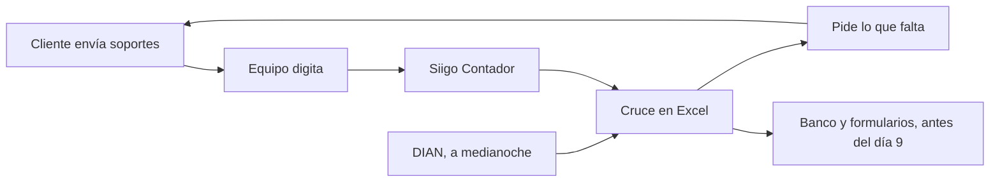
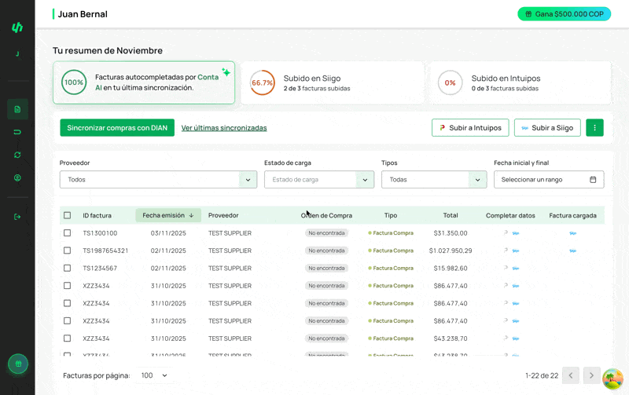
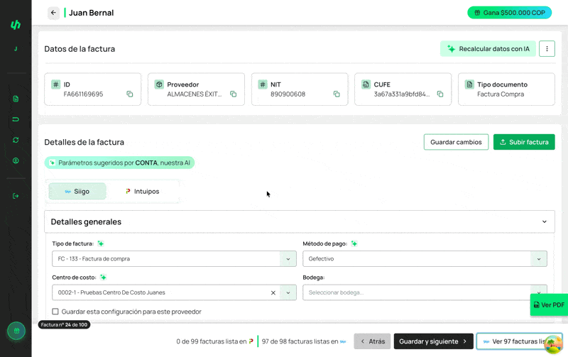
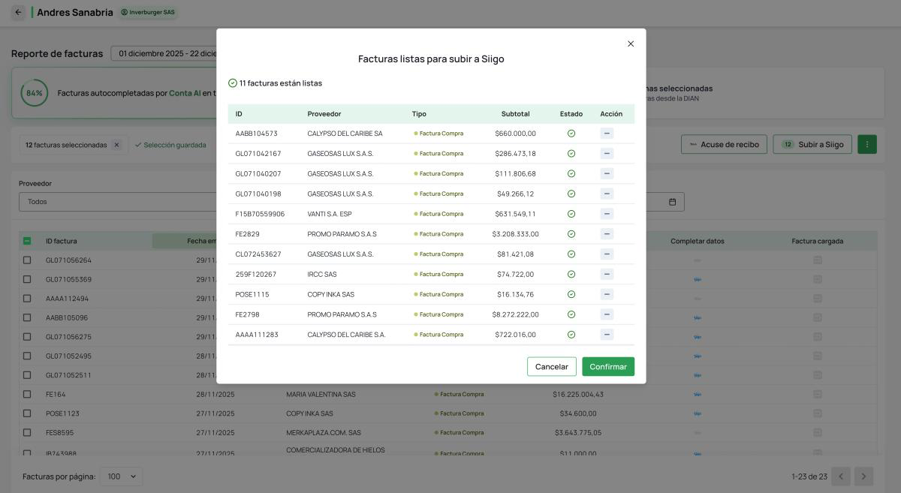

# Cierre mensual de Taxplan: lo que entendimos

**Para:** Meliza Ramírez Granados, Taxplan Consulting SAS
**De:** David Vargas y Julián, Webby
**Fecha:** 18 de noviembre de 2026

Meliza, gracias por la conversación del 5 de noviembre. Esta página resume cómo entendimos tu cierre mensual, qué proponemos para cada dolor y qué necesitamos confirmar contigo.

No es un precio. Siigo sigue siendo tu libro. Lo que proponemos es una consultoría para automatizar los dolores principales, empezando por una empresa, sin cambiar de sistema.

## Cómo cierra el mes hoy

Los soportes llegan por WhatsApp, correo, físico o USB. En paralelo, el reporte de facturación electrónica de la DIAN queda disponible a la medianoche. El equipo digita, cruza en Excel, pide lo que falta y concilia el banco. El cierre de cada empresa tiene que estar listo antes del día 9 del mes siguiente.

El orden que nos contaste es este:

1. **Causar.** Reconocer cada factura como gasto, con su IVA y su retención según el NIT. Sin NIT, ese gasto no se puede descontar.
2. **Conciliar.** Cada banco contra los libros. Lo que no cuadra se revisa a mano: anticipo, diferido, pago de otro mes o factura sin NIT.
3. **Liquidar.** Retefuente e IVA, y si aplican, ICA, impuesto al consumo y autorretención. Tú apruebas antes de presentar.
4. **Nómina.** La nómina electrónica se cruza al final, cuando queda oficial, hacia el 4 o el 5. No frena los tres pasos anteriores.

## Lo que proponemos

Siigo se queda como libro. Automatizamos los dolores puntuales alrededor de Siigo, uno por uno, y cada automatización tiene un humano que aprueba antes de que algo entre al libro.

| Dolor | Qué hace el agente | Solución propuesta |
|---|---|---|
| Causar a mano | Trae las facturas de la DIAN, propone la cuenta, el IVA y la retención, y deja el comprobante armado en Siigo | El agente deja cada factura armada y no la contabiliza si falta el NIT, si el CUFE ya existe o si nadie la aprobó |
| Conciliar con resaltador | Lee el extracto, cruza contra el auxiliar y separa lo que coincide de lo que no | Comisión y GMF se cierran con una regla. Anticipo, diferido, otro mes o un valor sin pareja quedan para una persona |
| Pedir soportes dos veces al mes | Compara la DIAN, lo recibido y lo causado, y le manda a cada cliente solo lo que le falta | Un recordatorio por empresa con la lista exacta de faltantes. No insiste sobre un documento que ya está causado |
| Reembolso de caja desde la foto | Lee el recibo y arma las líneas con el total | El borrador se confirma cuando alguien verifica que el total cuadra |
| Miedo a la sanción | Arma el borrador de retefuente, IVA y, si aplica, ICA, consumo y autorretención, con el soporte de cada cifra | Meliza revisa el borrador con su soporte. El agente no presenta ni paga |
| Nómina que no cuadra con el gasto | Cuando la nómina electrónica queda oficial, compara el costo contra los egresos y marca la diferencia | Lista de diferencias para revisar. El agente no ajusta el libro solo |

## Las automatizaciones, una por una

### 1. Causación de compras desde la DIAN

Cifrato sincroniza las compras con la DIAN, sugiere la causación y las sube a Siigo. Alguien de tu equipo revisa antes de confirmar. Más adelante podemos desarrollar esa misma causación para que quede inmediata y para bajar el costo de la herramienta.

Las pantallas siguientes son del [tutorial público de Cifrato](https://cifrato.ai/blog/como-causar-facturas-mas-rapido). Las empresas que aparecen son las del ejemplo, no las de Taxplan.

Resumen del mes: cuántas facturas autocompletó la IA y cuántas ya se subieron a Siigo.

Detalle de una factura. La IA propone tipo de documento, forma de pago y centro de costo. Se puede recalcular o corregir antes de subirla.

Confirmación para subir el lote a Siigo.

Lo que hay que confirmar en una prueba: que la integración con tu versión de Siigo funcione como muestra el tutorial, y cuánto cuesta por empresa.

### 2. Conciliación bancaria

Siigo permite conciliar con el extracto del banco, incluso en PDF. El sistema compara cada movimiento del extracto contra el auxiliar y propone cuáles se pueden conciliar de una vez. Lo que no cuadra queda para revisar: anticipo, diferido, pago de otro mes o una factura sin NIT.

La regla es la misma para todos los bancos: lo que coincide se cierra, lo que no coincide no entra solo al libro.

### 3. Borrador de retefuente, IVA, ICA y autorretención

Con el libro cuadrado, el borrador sale del balance por tercero. No presenta ni paga. Tú comparas el borrador con el formulario y decides.

El IVA por pagar, el impuesto al consumo y la autorretención siguen el mismo camino: entran al borrador solo si a esa empresa le aplican. El formulario de la DIAN lo sigues presentando tú.

### 4. Soportes por cliente y recordatorios

Cada cliente tiene un espacio propio, por NIT. Ve y carga solo sus documentos. Antes de cada cierre, el cliente recibe la lista exacta de lo que falta, no un mensaje general.

Arrastrar y soltar los archivos puede esperar a una segunda etapa. El espacio separado, no.

### 5. Lo que puede ir después

No cambia la declaración. Lo dejamos para cuando la primera etapa ya esté corriendo con unas pocas empresas:

- Arrastrar y soltar los soportes.
- Reembolso de caja a partir de la foto del recibo.
- Un vistazo del estado de cada empresa frente al día 9.
- Un tablero para que el cliente vea en qué va su mes.
- Causación inmediata, sin esperar el lote, y con menor costo.

## Lo que queda fuera de esta etapa

- Reemplazar Siigo.
- Presentar o pagar en la DIAN o en un municipio.
- Construir la información exógena.
- Declaraciones de personas naturales.
- Página, certificados en línea y chatbot.
- Obligar a tus clientes a dejar el WhatsApp o el físico.

La primera etapa sería con cinco o seis empresas, no con todas.

## Preguntas para la reunión

Con una empresa en pantalla, y un mes, nos alcanza. Si no tienes el mes cerrado a la mano, vemos lo que tengas.

**Cómo trabajas hoy**

1. ¿Cómo causas una factura en Siigo, de principio a fin?
2. ¿Cómo concilias el banco y qué haces cuando un movimiento no cuadra?
3. ¿El documento soporte llega hecho o lo elabora Taxplan?
4. ¿El Excel de la DIAN lo bajas del portal o de otro sistema?
5. ¿Qué versión de Siigo usan: Contador, Nube o Pyme?
6. ¿Tu licencia de Siigo ya trae la bandeja de compras de la DIAN y la conciliación con extracto?

**El mes de esa empresa**

7. ¿Nos puedes mostrar el Excel de la DIAN, un extracto y el balance de prueba de un mes ya cerrado?
8. ¿Cuántas facturas y cuántos bancos tiene un mes típico de esa empresa?
9. ¿Hay anticipos o diferidos que hoy no cuadran? ¿Son la excepción o pasan seguido?
10. ¿El reembolso de caja de esa empresa pesa en la renta del mes?

**Impuestos y nómina**

11. ¿El IVA de esa empresa es cada dos meses o cada cuatro?
12. ¿Retiene IVA?
13. ¿Le aplican ICA, impuesto al consumo o autorretención?
14. ¿En qué fecha queda oficial la nómina electrónica?
15. Si la empresa es de ganadería: ¿el inventario de animales mueve la renta de ese mes?

**El equipo**

16. ¿Quién causa, quién concilia y quién aprueba cuando tú no estás?

## Siguiente paso

1. Nos reunimos una vez, con una empresa en pantalla.
2. Revisamos qué de esta lista ya hace Siigo en esa licencia.
3. Probamos la causación con Cifrato en esa empresa, sin cambiar el libro.
4. Te enviamos la propuesta de consultoría por dolor, con precio.

Si algo de esta página no coincide con tu operación, dínoslo y lo corregimos.
